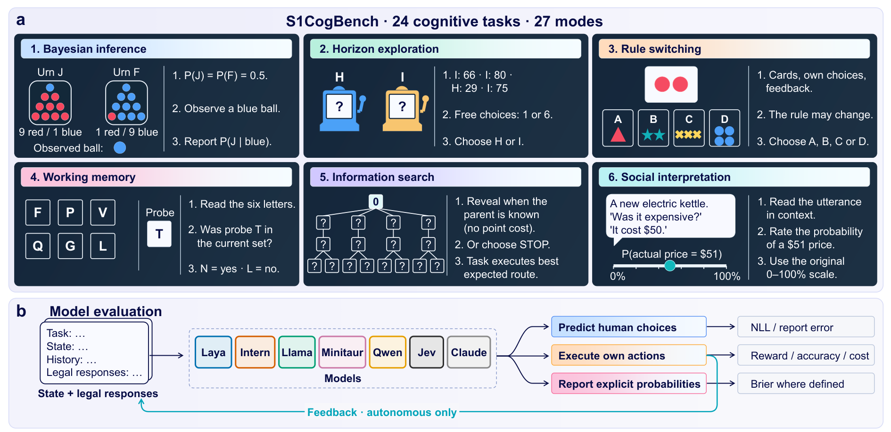
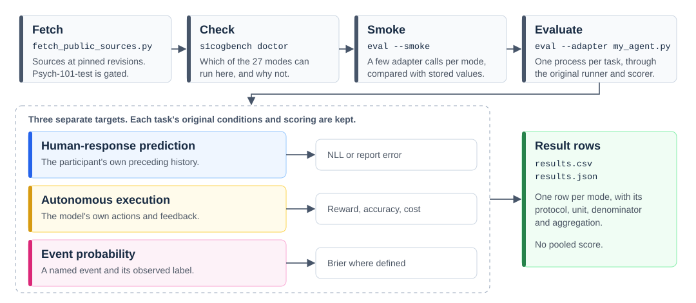

<h1 align="center">S1CogBench</h1>

<h2 align="center">
  What System One Decision Models Can and Cannot Do on Cognitive Experiments
</h2>

<p align="center">
  <a href="https://arxiv.org/abs/2611.00911"></a>
  <a href="https://huggingface.co/datasets/dengzhe-hou/S1CogBench"></a>
  <a href="docs/QUICKSTART.md"></a>
  <a href="results/aggregate/table2.csv"></a>
  <a href="task_catalog.json"></a>
  <a href="LICENSE"></a>
</p>

<p align="center">
  <a href="docs/assets/fig1.png">
    
  </a>
</p>

<p align="center">
  <em>S1CogBench connects cognitive tasks to model evaluation.</em>
</p>

Language models are no longer used only to generate text. Software also asks them for decisions, in routing, guardrails, and automated gates. System One (System-1) decision models, also called typed decision models, such as Jev, Laya, and Intern-Decision, return one fast decision over the legal options, leaving no text to inspect, and a fast, well-formed decision does not show that the model used the evidence. **S1CogBench** asks what these models can and cannot do on established cognitive experiments, keeping each task's conditions and scoring apart from disclosed adaptations, and scoring human-response prediction, autonomous execution, and event probabilities separately. The released arXiv snapshot covers five open models and Jev on 24 tasks (27 modes). To our knowledge, it is the first benchmark of System One decision models on established cognitive experiments, and it gives a shared test of whether their decisions respond to evidence, feedback, memory load, and future opportunities before software relies on them.

Read the paper on [arXiv](https://arxiv.org/abs/2611.00911). The aggregate results are also on [Hugging Face](https://huggingface.co/datasets/dengzhe-hou/S1CogBench).

## Add a model or inspect a protocol

Start with [the new-model guide](docs/ADD_MODEL.md). The plan command lists the original inputs, denominators and adapter requirements without importing a model or reading datasets.

```bash
python -m s1cogbench plan --tasks all --json
python -m s1cogbench plan --adapter my_agent.py --tasks all --json
```

Use [the comparison guide](docs/COMPARISON_GUIDE.md) to distinguish action rules and score targets. [Release scope](docs/RELEASE_SCOPE.md) separates the released aggregate from later manuscript evidence and tooling changes. Existing numeric results are preserved.

## Quick Start

**Run every mode through its original runner and scorer in about two minutes.** The smoke run makes a few calls per mode with a uniform reference adapter, on one CPU, with no model weights.

> [!CAUTION]
> Reproducing the 2026-10-26 CPU validation bit for bit needs Python 3.11. Under Python 3.12, 6 of the 27 modes differ in the last digits of floats, because Python 3.12 made the built-in float `sum()` compensated.

```bash
git clone https://github.com/dengzhe-hou/S1CogBench.git
cd S1CogBench
python3.12 -m venv .venv && source .venv/bin/activate
python -m pip install -r requirements.txt
```

> [!CAUTION]
> Psych-101-test is gated. Eight modes stop at `doctor` until you accept its conditions on Hugging Face and run `fetch_public_sources.py psych101`. Do not redistribute the file or the per-item outputs of those modes, which contain source responses.

```bash
python scripts/fetch_public_sources.py all     # public sources at pinned revisions
python -m s1cogbench doctor                    # which of the 27 modes can run here, and why not
```

```bash
python -m s1cogbench eval --smoke --output runs/smoke
```

The last line says `SMOKE PASSED`, or lists the differences in `runs/smoke/smoke_check.json`.

**Then evaluate your own model.** An adapter is a Python file with `create_agent(device)`, and a template is the shortest way to write one.

> [!CAUTION]
> `--output` must be a new directory inside the repository, for example `runs/my-model`. The original runners refuse to write anywhere else.

```bash
python -m s1cogbench eval --adapter my_agent.py --device cuda:0 --model-label my-model \
    --tasks all --output runs/my-model
```

[Read the full quickstart](docs/QUICKSTART.md) · [Write an adapter](docs/MODELS.md)

## From a task source to a result row

[](docs/assets/workflow.svg)

`eval` runs each task in its own process, through the original runner and scorer that produced the accepted results, and writes `results.csv` and `results.json` with one row per mode for its Table 3 primary target. Each row has the [result schema](results/aggregate/result_schema.json) and the comparison context of the accepted rows, and raw per-item outputs stay under `runs/my-model/<task>/<mode>/`. There is no pooled score. Infinite NLL, the undefined all-invalid MAE and negative values remain in the result files.

[Read the protocols](docs/PROTOCOLS.md) · [Group results by context](results/aggregate/grouping_guide.md)

## Data & Models

| Resource | Where to start |
| --- | --- |
| 24 evaluated tasks in 27 modes, and 7 deferred paradigms | [Open the task catalogue](task_catalog.json) |
| 18 modes on public sources at pinned revisions | [Read the data guide](docs/DATA.md#fetch) |
| Mouselab autonomous, which also needs Julia 1.4.1 | [Set up Julia](docs/DATA.md#julia-for-mouselab-autonomous) |
| 8 modes on the gated Psych-101-test | [Request access](docs/DATA.md#gated-psych-101-test) |
| Accepted results and Table 3 | [All rows](results/aggregate/results.csv) · [Table 3](results/aggregate/table2.csv) |
| Weights of the evaluated models, not bundled | [Find the adapters](docs/MODELS.md#adapters-of-the-accepted-rows) |

The released arXiv snapshot evaluates five open models and Jev on 24 tasks (27 modes), and Claude on selected modes.

| Model | Access | Modes | Adapter or template |
| --- | --- | --- | --- |
| Laya English | Open weights | All 27 | [`laya_choice_agent.py`](examples/laya_choice_agent.py) |
| Intern-Decision-4B | Open weights | All 27 | [`intern_decision_choice_agent.py`](examples/intern_decision_choice_agent.py) |
| Llama-3.1-8B-Instruct | Open weights | All 27 | [By mode](docs/MODELS.md#adapters-of-the-accepted-rows) |
| Minitaur8B | Open weights | All 27 | [`minitaur8b_choice_agent.py`](examples/minitaur8b_choice_agent.py) |
| Qwen3.5-4B | Open weights | All 27 | [`qwen35_4b_choice_agent.py`](examples/qwen35_4b_choice_agent.py) |
| Jev 1.14 | API | All 27 | [`decision_api_choice.py`](examples/templates/decision_api_choice.py) |
| Claude Opus 5.5 | API | 2 | [`generative_api_choice.py`](examples/templates/generative_api_choice.py) |
| Claude Sonnet 5.5 | API | 3 | [`generative_api_choice.py`](examples/templates/generative_api_choice.py) |
| Claude Haiku 5.5 | API | 15 | [`generative_api_choice.py`](examples/templates/generative_api_choice.py) |
| Your Hugging Face model | Your weights | Any | [`hf_causal_lm_choice.py`](examples/templates/hf_causal_lm_choice.py) |

> [!NOTE]
> All 27 modes run through the CLI with the CPU reference adapters. Among neural models, Llama-3.1-8B on a whole A100 is supported. In a pass of 20 calls per mode, all 23 comparable modes match the accepted runs exactly. On a MIG slice of an A100, prompts and identities match but probabilities differ by BF16 rounding steps, so the support does not extend to slices, and expect Llama numbers from a slice to differ from the accepted rows. The accepted results came from the original runners with model-specific adapters or published prompts, and the other neural models have not run through the CLI. See [REPRODUCTION.md](docs/REPRODUCTION.md).

## Baselines

Each reference keeps its own target, fit and provenance. A human-action NLL is not an autonomous-return comparator, and there is no global reference score.

| Reference | Task modes | Ref. type | Provenance | Ref |
| --- | --- | --- | --- | --- |
| Uniform | All 27 | Control | Analytic expectation | [Definitions](docs/BASELINES.md#uniform-column) |
| Exact Bayes | Bayesian urn | Optimal | Analytic solution | [Guide](docs/BASELINES.md#bayesian-urn) |
| Multiple-cue formula reimplementation | Multiple-cue judgment | Human fit | Disclosed reimplementation | [Guide](docs/BASELINES.md) |
| WADD | Multi-attribute choice | Human fit | Disclosed reimplementation | [Guide](docs/BASELINES.md#recovered-references-for-the-existing-table-3-targets) |
| Median report of training participants | Probability coherence | Human | Independent fit | [Guide](docs/BASELINES.md#human-response-references) |
| GCM | SHJ, Medin, Weather | Human fit | Disclosed reimplementation | [Guide](docs/BASELINES.md#recovered-references-for-the-existing-table-3-targets) |
| RLWM archived fitted cognitive models | RLWM | Human fit | Archived replay | [Guide](docs/BASELINES.md#rlwm-and-horizon) |
| Rational conditional-response model | Recent probes | Human fit | Disclosed reimplementation | [Guide](docs/BASELINES.md#recovered-references-for-the-existing-table-3-targets) |
| SL (local refit) | WCST, both modes | Human fit | Official code | [Guide](docs/BASELINES.md) |
| Two-parameter Q-learning | Restless bandit | Algorithm | Disclosed reimplementation | [Guide](docs/BASELINES.md#restless-q-learning) |
| Rescorla-Wagner with separate learning rates | Instrumental learning | Algorithm | Disclosed reimplementation | [Guide](docs/BASELINES.md#autonomous-references) |
| RW3 (local formula fit) | Horizon, both modes | Human fit | Disclosed reimplementation | [Guide](docs/BASELINES.md#rlwm-and-horizon) |
| Thompson family | Stationary bandits | Algorithm | Official code and disclosed reimplementation | [Guide](docs/BASELINES.md#recovered-references-for-the-existing-table-3-targets) |
| Independent end-to-end ANN | Hybrid sampling | Human fit | Disclosed reimplementation | [Guide](docs/BASELINES.md) |
| MetaGreedy (official implementation) | Mouselab, prediction | Human fit | Official code | [Guide](docs/BASELINES.md) |
| MetaGreedy, archived fitted parameters | Mouselab, autonomous | Human fit | Disclosed reimplementation | [Guide](docs/BASELINES.md#mouselab-metagreedy) |
| Fixed pump threshold per balloon letter | BART | Algorithm | Independent fit | [Guide](docs/BASELINES.md#autonomous-references) |
| Later-reward rate of Psych-101 participants | Temporal discounting | Human | Human data summary | [Guide](docs/BASELINES.md#human-response-references) |
| Hybrid model fits to CogBench participants | Two-step | Human fit | Disclosed reimplementation | [Guide](docs/BASELINES.md#autonomous-references) |
| ToMi answer key | False-belief QA | Optimal | Answer key | [Guide](docs/BASELINES.md#false-belief-qa) |
| Other participants, leave one out | Politeness, Pragmatic interpretation | Human | Human data summary | [Guide](docs/BASELINES.md#human-response-references) |
| Human split-half | Nonliteral number | Human | Human data summary | [Guide](docs/BASELINES.md#human-response-references) |
| Lookup table | Self-assessment | Human fit | Disclosed reimplementation | [Guide](docs/BASELINES.md#human-response-references) |

[Reference values](results/aggregate/reference_results.json) · [Fit and exposure provenance](results/aggregate/baseline_provenance.json)

## Documentation

| I want to… | Guide |
| --- | --- |
| Run my first evaluation | [Quickstart](docs/QUICKSTART.md) |
| Write an adapter for my model | [Models and adapters](docs/MODELS.md) |
| Get the data and check its terms | [Data](docs/DATA.md) · [License status](docs/LICENSE_STATUS.md) |
| Read the protocols and scoring targets | [Protocols](docs/PROTOCOLS.md) |
| Look up a number in Table 3 | [Results guide](docs/RESULTS.md) · [The row behind each cell](results/aggregate/table2.json) |
| Compare results without mixing contexts | [Grouping guide](results/aggregate/grouping_guide.md) · [Metric applicability](results/aggregate/metric_status.json) |
| Understand a reference or the Uniform column | [Baselines](docs/BASELINES.md) |
| See what has been reproduced and what has not | [Reproduction](docs/REPRODUCTION.md) · [CPU validation](docs/CPU_REUSE_VALIDATION_24.md) |
| Read the Jev and Claude settings, time and cost | [API extension](docs/API_EXTENSION.md) · [Time and cost](docs/API_TIME_COST.md) |
| Read the latency, generation and readout controls | [Supplementary controls](docs/SUPPLEMENTARY_CONTROLS.md) · [Latency](docs/LATENCY.md) |
| Share my results | [Submit results](docs/SUBMIT_RESULTS.md) |

<details>
<summary><strong>Repository structure</strong></summary>

```text
s1cogbench/   The command line: list, plan, doctor, eval, smoke
scripts/      Source fetching, the original task runners, Table 3 and homepage builders
src/          Task loaders, environments and scorers
examples/     Model adapters and templates
results/      Accepted aggregate results, references and Table 3
docs/         Guides and retained records
experiments/  Portable code of the supplementary controls
derived/      Inputs derived from published code
envs/         The pinned Julia environment for Mouselab
homepage/     The project page source
tests/        Offline tests of adapter templates and evaluation entry behavior
```

</details>

## Citation

If you use S1CogBench in your research, please cite.

```bibtex
@misc{hou2026s1cogbench,
  title         = {{S1CogBench}: What System One Decision Models Can and Cannot Do on Cognitive Experiments},
  author        = {Hou, Dengzhe and Yamada, Kazunori D},
  year          = {2026},
  eprint        = {2611.00911},
  archivePrefix = {arXiv},
  primaryClass  = {cs.CL},
  url           = {https://arxiv.org/abs/2611.00911}
}
```

## License

Original S1CogBench project software is licensed under [MIT](LICENSE). Third-party code, models and data keep their original terms, and gated participant data and model weights are not bundled. See [license status](docs/LICENSE_STATUS.md).
